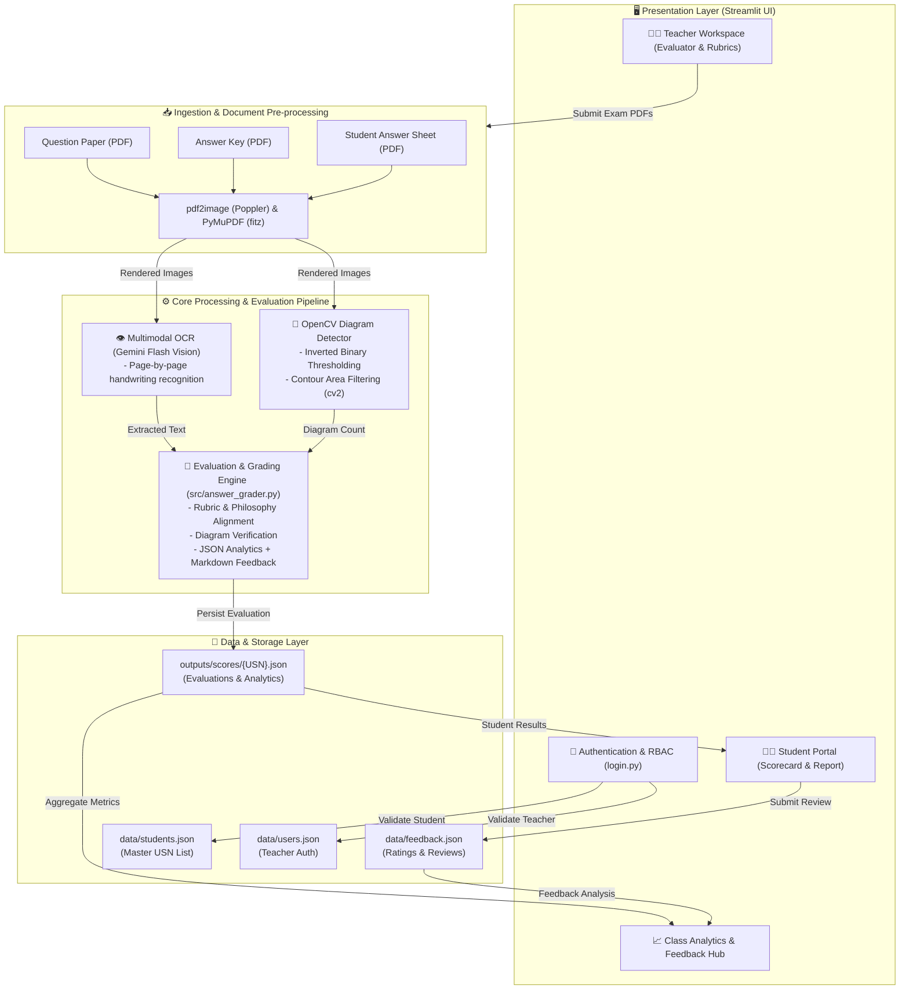

# 🤖 SmartEval — AI-Powered Automated Answer Sheet Evaluation & Analytics

[](https://streamlit.io/)
[](https://ai.google.dev/)
[](https://opencv.org/)
[](https://plotly.com/)
[](https://www.python.org/)

**SmartEval** (SmartEvolve) is an intelligent, automated handwritten answer sheet evaluation, grading, and analytics platform. Designed for educators and academic institutions, SmartEval combines **multimodal AI (Google Gemini)** and **computer vision (OpenCV)** to digitize handwritten exam papers, detect diagrams, evaluate student responses against official answer keys and customized rubrics, and deliver actionable visual performance analytics.

---

## 🌟 Key Features

### 1. 📑 Intelligent Multi-Document Ingestion
- Uploads and processes three core documents simultaneously:
  1. **Question Paper** (PDF)
  2. **Official Answer Key / Scheme of Evaluation** (PDF)
  3. **Student Handwritten Answer Sheet** (PDF)
- Automated high-resolution page rendering (150–200 DPI) using `pdf2image` (Poppler) and `PyMuPDF` (`fitz`).

### 2. 👁️ Multimodal OCR & Handwriting Extraction
- Uses **Google Gemini Multimodal Vision API** to accurately decipher messy student handwriting, mathematical equations, and structured responses across multi-page scripts.
- Preserves layout, question numbering, line breaks, and sub-part hierarchies.

### 3. 📐 Computer Vision Diagram & Sketch Detection
- Native **OpenCV (`cv2`)** image processing pipeline that isolates non-text visual artifacts.
- Applies grayscale conversion, inverted binary thresholding, and contour area filtering (`10,000 < area < 500,000`) to automatically count and verify technical drawings, flowcharts, circuits, and Gantt charts.
- Passes diagram counts into the evaluation model to assess diagram completeness against rubric expectations.

### 4. ⚖️ Configurable AI Grading Modes
Tailor evaluation rigor to institutional standards:
- **Reasonable / Moderate (Standard):** Balanced university-level grading; tolerates minor spelling/OCR variance while penalizing conceptual errors.
- **Easygoing / Lenient:** Generous partial credits; prioritizes demonstrated understanding over exact phrasing.
- **Stringent / Strict:** Rigorous keyword matching; full credit requires complete, technically precise answers matching the marking scheme.

### 5. 📊 Deep Analytics & Interactive Dashboards
- **Educator / Class Dashboard:**
  - Class average speedometer gauge chart.
  - Pass/Fail distribution donut chart.
  - Question difficulty ranking bar chart (identifies toughest vs. easiest exam topics).
  - Class completion rates and real-time evaluation logs.
- **Student Dashboard:**
  - Instant visibility into graded papers.
  - Comprehensive question-wise and sub-part score breakdowns (`marks awarded`, `max marks`, and contextual feedback).
  - Identification of **Key Strengths** and **Areas for Improvement**.
  - Downloadable Markdown evaluation reports.

### 6. 🔐 Role-Based Access Control (RBAC) & Feedback Hub
- **Student Portal:** Seamless ID/USN-based verification against an institution's master student roster (`data/students.json`).
- **Teacher/Admin Portal:** Secure authentication with SHA-256 hashed credentials, self-registration, and evaluation assignment.
- **Feedback System:** In-app rating and review system for students and faculty, aggregated in a dedicated feedback analytics center.

---

## 🏗️ System Architecture

### Visual Architecture Diagram

```text
+--------------------------------------------------------------------------------------------------+
|                                    SMARTEVAL SYSTEM ARCHITECTURE                                 |
+--------------------------------------------------------------------------------------------------+

  [ CLIENT / USER INTERFACES (Streamlit) ]
      |
      +---> 🧑‍🎓 Student Portal
      |         • Enter USN (Verified against data/students.json)
      |         • View Scorecard, Question-Wise Breakdown & Motivational Feedback
      |         • Download Markdown Evaluation Report
      |         • Submit Experience Feedback (1-5 Stars + Comments)
      |
      +---> 👩‍🏫 Teacher & Admin Portal
                • Secure Auth (SHA-256 in data/users.json)
                • Evaluation Workspace (Upload Question Paper, Scheme & Student Script)
                • Dynamic Class Dashboard (Class Average, Pass/Fail Donut, Hardest Questions)
                • Central Feedback Hub & Audit Trail

                                              |
                                              v (Upload PDFs: Exam Paper, Scheme, Student Script)
  [ INGESTION & PRE-PROCESSING ]
      |
      +---> pdf2image (Poppler) & PyMuPDF (fitz)
                • High-Resolution Rasterization (150-200 DPI)
                • Generates base64 / JPEG page sequences
                • Saves temp files (temp_q.pdf, temp_k.pdf, temp_s.pdf)

                                              |
                        +---------------------+---------------------+
                        |                                           |
                        v                                           v
  [ COMPUTER VISION PIPELINE ]                     [ MULTIMODAL AI OCR ]
    (OpenCV / cv2)                                   (Google Gemini Flash Vision)
    • Grayscale & Invert Thresholding                 • Page-by-page handwriting recognition
    • Contour Extraction (cv2.findContours)           • Transcribes questions, student notes,
    • Area Filtering (10k < area < 500k)                and answer keys while preserving structure
    • Outputs: Estimated Diagram Count                • Outputs: Transcribed Markdown Text
                        |                                           |
                        +---------------------+---------------------+
                                              |
                                              v
  [ AI EVALUATION & REASONING ENGINE ] (src/answer_grader.py)
      • Multi-Factor Context Integration:
          [ Question Paper Text ] + [ Official Answer Key ] + [ Student Text ]
          + [ OpenCV Diagram Count ] + [ Custom Rubrics & Rules ]
      • Configurable Evaluation Philosophies:
          - Reasonable (Standard academic rigor)
          - Easygoing (Lenient partial credits)
          - Stringent (Strict keyword & criteria matching)
      • Structured Generation:
          ├── Task 1: Structured Analytics JSON (Total, Section-wise, Question-wise, Table)
          └── Task 2: Student-Facing Feedback Markdown Report (Strengths & Improvements)

                                              |
                                              v
  [ PERSISTENCE & DATA LAYER ]
      ├── outputs/scores/{USN}.json     --> Complete evaluation record, scores & report
      ├── outputs/diagram_temp/         --> Detected diagram image contours
      ├── data/feedback.json            --> Aggregated student & teacher feedback
      └── data/users.json               --> User credentials & roles

                                              |
                                              v
  [ ANALYTICS & VISUALIZATION ENGINE ] (dashboard.py)
      • Plotly Speedometer Gauge Chart (Class Average %)
      • Plotly Donut Chart (Pass / Fail Ratio)
      • Plotly Gradient Bar Chart (Question Difficulty: Hardest -> Easiest)
      • Interactive DataFrames (Detailed sub-part marking breakdowns)
+--------------------------------------------------------------------------------------------------+
```

### Interactive Mermaid Flowchart



### Architectural Flow Breakdown

1. **Client / Interaction:** Users authenticate via `login.py`. Students enter their USN to pull results, while instructors access the evaluation suite and administrative dashboards.
2. **Preprocessing Pipeline (`src/ocr_extraction.py` & `src/diagram_detection.py`):**
   - PDFs are converted into high-resolution bitmap frames.
   - Student sheets are routed in parallel to the OpenCV contour analyzer (to estimate drawn diagrams) and to Google Gemini (for vision-based OCR text extraction).
3. **Reasoning & Scoring Core (`src/answer_grader.py`):**
   - Synthesizes extracted student answers, question constraints, official answer keys, diagram counts, and teacher rubrics into structured Gemini prompts.
   - Enforces a dual-output contract:
     - Structured JSON containing itemized scoring metrics, section-wise marks, question-wise percentages, and diagram metrics.
     - Student-facing Markdown report detailing performance praise and actionable feedback.
4. **Persistence & Visualization (`dashboard.py` & `app.py`):**
   - Results are committed to `outputs/scores/{USN}.json`.
   - Real-time Plotly charts generate class averages, pass rates, and item difficulty distributions.

---

## 📂 Project Structure

```text
Smart_Eval-main/
│
├── app.py                      # Main Streamlit application and page router
├── dashboard.py                # Class-level analytics, Plotly charts, and statistics
├── login.py                    # Multi-role authentication (Student USN / Teacher login)
├── feedback.py                 # Personalized feedback generation & grading templates
├── requirements.txt            # Python package dependencies
│
├── src/                        # Core backend modules
│   ├── answer_grader.py        # Gemini grading engine & prompt orchestration
│   ├── diagram_detection.py    # OpenCV contour detection for diagrams/charts
│   ├── evaluation_mode.py      # Score adjustment logic (Lenient / Moderate / Strict)
│   ├── feedback_handler.py     # Feedback storage and retrieval helpers
│   ├── ocr_extraction.py       # PDF-to-image conversion & Gemini multimodal OCR
│   └── utils.py                # JSON persistence and timestamp utilities
│
├── assets/                     # Media & UI styling assets
│   ├── logo.png                # Platform branding logo
│   ├── logo.mp4                # Background video for futuristic theme
│   ├── logo.json               # Animation assets
│   └── ani.lottie              # Lottie animation assets
│
├── data/                       # Local data stores & sample documents
│   ├── students.json           # Master list of enrolled student USNs
│   ├── users.json              # Registered teacher/admin user credentials (hashed)
│   ├── feedback.json           # Student and teacher submitted reviews
│   ├── question_paper.pdf      # Sample exam question paper
│   ├── answer_key.pdf          # Sample official evaluation scheme
│   └── answer_sheets/          # Sample student handwritten papers
│
├── outputs/                    # Output directory for evaluations
│   ├── scores/                 # Evaluated student score JSONs ({USN}.json)
│   ├── diagram_temp/           # Temporary cropped diagram images
│   └── extracted_answers/      # Extracted student scripts (cached)
│
├── tests/                      # Verification and test scripts
│   └── test_feedback_run.py    # Test harness for feedback generation
│
└── .devcontainer/              # VS Code Dev Container configuration
    └── devcontainer.json
```

---

## 🛠️ Technology Stack

| Component | Technology | Description |
| :--- | :--- | :--- |
| **Frontend & UI** | [Streamlit](https://streamlit.io/) | Web application interface with responsive layout |
| **Styling & Theme** | Custom CSS & HTML5 | Dark mode, glassmorphism, animated tabs, and glowing neon accents |
| **AI / Multimodal LLM** | [Google Gemini Flash](https://ai.google.dev/) (`google-generativeai`) | Multimodal handwriting recognition & academic evaluation |
| **Computer Vision** | [OpenCV](https://opencv.org/) (`opencv-python-headless`) | Thresholding, edge detection, and contour analysis |
| **PDF Processing** | [PyMuPDF](https://pymupdf.readthedocs.io/) (`fitz`) & `pdf2image` | Native high-speed PDF rasterization into JPEG/PNG images (Zero external dependencies) |
| **Visual Analytics** | [Plotly](https://plotly.com/python/) & [Pandas](https://pandas.pydata.org/) | Dynamic gauge indicators, donut charts, and gradient bar charts |

---

## 🚀 Getting Started

### Prerequisites

- **Python 3.10+** (Python 3.11 recommended)
- **Google Gemini API Key** (Obtain from [Google AI Studio](https://aistudio.google.com/))
- **No manual Poppler configuration required!** SmartEval utilizes PyMuPDF (`fitz`) for native, high-speed PDF rendering out-of-the-box. (If `pdf2image` is ever used as a fallback, Poppler is auto-resolved from the system environment without requiring any user input).

---

### Installation

1. **Clone the Repository:**
   ```bash
   git clone https://github.com/your-username/Smart_Eval.git
   cd Smart_Eval-main
   ```

2. **Create and Activate a Virtual Environment:**
   ```bash
   python3 -m venv venv
   # On macOS/Linux:
   source venv/bin/activate
   # On Windows:
   .\venv\Scripts\activate
   ```

3. **Install Dependencies:**
   ```bash
   pip install -r requirements.txt
   ```

---

### Configuration & Running the Application

1. **Launch the Streamlit App:**
   ```bash
   streamlit run app.py
   ```
2. **Access the Web Interface:**
   Open your browser and navigate to `http://localhost:8501`.
3. **Configure Gemini API Key:**
   - Log in as a Teacher or Admin.
   - Navigate to **⚙️ Settings** in the sidebar.
   - Input your Google Gemini API key and click **Save Key**.
   *(Note: You can also configure the Poppler binary path directly from the Evaluation page sidebar on Windows).*

---

## 📖 User Workflow Guide

### For Instructors & Evaluators

1. **Log in / Sign Up:** Use the **Teacher / Admin** tab to sign in or register a new faculty account.
2. **Configure Evaluation:**
   - Set the Subject/Course Name (e.g., `Operating Systems - Internal 1`).
   - Navigate to the **🚀 Evaluate** page.
3. **Upload Documents:**
   - Enter the student's registered University Seat Number (**USN**).
   - Select the **Evaluation Mode** (*Reasonable*, *Easygoing*, or *Stringent*).
   - Upload the Question Paper PDF, Answer Key PDF, and Student's Answer Sheet PDF.
   - (Optional) Provide custom scoring rubrics or question instructions in the text area.
4. **Execute Evaluation:** Click **Start Evaluation**. The progress indicator tracks PDF conversion, OCR transcription, diagram counting, and rubric grading.
5. **Review Results:**
   - Inspect the **Evaluation Report** tab for itemized marks and qualitative feedback.
   - View visual distributions under **Analytics**.
   - Audit extracted text in **Extracted Text (Debug)**.
   - Download the full student report as a Markdown file.

### For Students

1. **Student Login:** Select **Student** on the login screen and enter your registered **USN** (e.g., `2C30309`).
2. **View Evaluation:**
   - If evaluated, view your total score, question breakdown, strengths, and areas for improvement.
   - Inspect your performance analytics charts.
   - Download your personalized report.
3. **Submit Feedback:** Use the **Submit Feedback** tab to rate the grading quality and share feedback with instructors.

---

## ⚡ Production REST API & Cloud Deployment

In addition to the interactive Streamlit sandbox, SmartEval includes a **high-throughput, asynchronous FastAPI backend** designed for production scale, database persistence, and multi-tenant cloud deployments.

### Features of the Production Backend:
- **Asynchronous Task Queue**: Submitting student papers returns immediately (`HTTP 202 Accepted`), processing evaluations in the background without blocking.
- **Batch Evaluation**: Endpoint to upload entire batches of student PDFs in a single request.
- **OCR Caching**: Question papers and answer schemes are OCR-transcribed **once** upon exam creation, reducing evaluation time by 60% and cutting LLM token costs.
- **Parallel Page Processing**: Multi-page student sheets are digitized concurrently using multi-threading.
- **Relational Persistence**: Uses SQLAlchemy with automatic support for **PostgreSQL** in production or SQLite in local development.

### Running the Production REST API

1. **Launch the FastAPI Server:**
   ```bash
   uvicorn server.main:app --host 0.0.0.0 --port 8000 --reload
   ```

2. **Explore the Interactive OpenAPI / Swagger Documentation:**
   Open your browser and navigate to:
   - **Swagger UI:** [http://localhost:8000/docs](http://localhost:8000/docs)
   - **ReDoc:** [http://localhost:8000/redoc](http://localhost:8000/redoc)

### Running with Docker & Docker Compose

Deploy the entire stack (FastAPI backend + PostgreSQL 16 + Redis + Streamlit UI) with a single command:

```bash
docker compose up --build
```

- **FastAPI API & Docs:** `http://localhost:8000/docs`
- **Streamlit Interactive UI:** `http://localhost:8501`
- **PostgreSQL Database:** `localhost:5432`

---

## 🧪 Testing

A standalone test script is provided to verify feedback formatting and rubric generation without triggering live API calls:

```bash
python tests/test_feedback_run.py
```

---

## 🔒 Security & Privacy Notes

- Passwords for teacher accounts are securely hashed with SHA-256 before storage in `data/users.json`.
- API keys entered via the Settings UI are kept in the active Streamlit session state and are not written to public git commits.
- Exam PDFs and score files remain local to your instance under `data/` and `outputs/`.

---

## 🤝 Contributing

Contributions are welcome! Please follow these steps:
1. Fork the project repository.
2. Create your feature branch (`git checkout -b feature/AmazingFeature`).
3. Commit your changes (`git commit -m 'Add some AmazingFeature'`).
4. Push to the branch (`git push origin feature/AmazingFeature`).
5. Open a Pull Request.

---

## 📄 License

This project is licensed under the [MIT License](LICENSE) (or institutional equivalent). See the repository headers for details.
